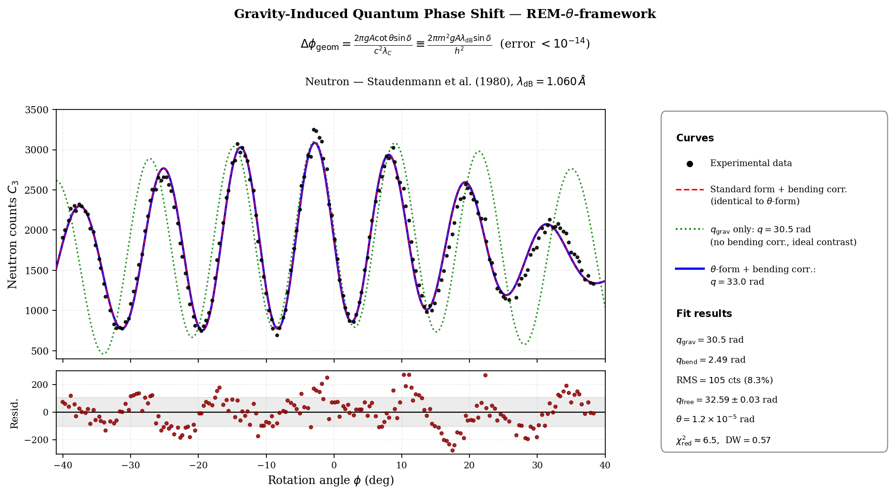

# REM-θ-framework — Lorentz Boost θ-Parametrization & Gravitational Interferometry

Companion simulation code for the article *"Relativistic electromagnetic mass:
applications to the Lorentz boost and gravitational quantum interferometry"*
(Article 2 of the REM-θ-framework).

This repository contains two independent, self-contained simulation sets:

| Folder | What it checks |
|---|---|
| [`lorentz_boost/`](lorentz_boost/) | The θ-parametrization of the Lorentz transformation matrix (γ = sec θ) against the standard formulation and against a 60-digit reference, for six physical inputs (velocity, total energy, kinetic energy, momentum, de Broglie wavelength, time dilation) |
| [`gravitational_interferometry/`](gravitational_interferometry/) | The geometric rewriting of the gravitationally-induced quantum phase shift (Δφ = 2πgA·cotθ·sinδ / c²λ_C), compared with the standard formula for neutron interferometry (COW effect, digitized experimental data). Electrons and photons are not treated |

## Important: proof of concept, not experimental validation

The θ-parametrization and the standard formulation are algebraically
identical, so the simulations necessarily agree with standard physics wherever
standard physics is already experimentally validated. **This is expected by
construction; it is not an independent experimental test of the underlying
REM-θ-framework.** These scripts are proof-of-concept and internal-consistency
checks.

Numerical residuals are **not** a single machine-precision constant. For the
boost matrix, the metric residual is ≤ 4.4×10⁻¹⁶ for β ≤ 0.7 and grows roughly
as 10⁻¹⁵·γ² (about 2×10⁻¹² at γ ≈ 70). The scripts print and save the actual
numbers on every run.

## Requirements

```
Python >= 3.9
numpy >= 1.21
matplotlib >= 3.5
scipy >= 1.7      (used by the neutron fit)
```

The 60-digit reference uses only the standard-library `decimal` module.

```bash
pip install -r requirements.txt
```

## Quick start

```bash
# Lorentz boost: validation, benchmark, figures, results file
cd lorentz_boost
python lorentz_theta_complete.py

# Gravitational interferometry (COW)
cd ../gravitational_interferometry
python cow_simulation_final.py
```

Both scripts write their outputs next to the script, so they can be run from
any directory.

---

## `lorentz_boost/`

**`lorentz_theta_complete.py`** — validation suite, benchmark and figures.

Figures (in the order they appear in Section 3.1 of the article):

1. `figA2_performance.png` — computational performance and precision of the
   inputs: speedup (median of 15 trials in random order) and error of γ and βγ
2. `figA3_heatmaps.png` — element-by-element comparison of the 4×4
   transformation matrix (independently written standard matrix vs
   θ-parametrized matrix)
3. `figA1_equivalence_stability.png` — algebraic equivalence and numerical
   stability across 9 decades of γ, against a 60-digit reference (standard
   formula and the six inputs)
4. `figA4_validation.png` — structural properties of Λ(θ): metric, collinear
   composition and inverse for 6 directions × 3 velocities

Numerical studies written to `lorentz_results.txt`:

* random-matrix test (`--nmatrix`, default 10⁶ boosts, random directions,
  β ∈ [0.01, 0.9999]) with the residual scaling in γ
* float64 matrices vs a 60-digit reference
* benchmark speedups (see the baseline note below)
* float32: β input vs momentum input
* θ → 0: (γ−1) and tan θ near the Galilean limit
* the multiplicative composition rule tan(π/4 + θ/2)

```bash
python lorentz_theta_complete.py [--n 1000000] [--nmatrix 1000000] [--nref 500]
                                 [--outdir ./figures] [--quiet] [--skip-figures]
```

The speedup values to paste into the article's Table 1 are in the "[3]
Benchmark" section of `lorentz_results.txt`.

**Benchmark (v1.8, equal footing).** Every input starts from the raw physical
quantity (v, E, K, pc, λ_dB, t) and does its own normalization (one division by
c, E₀, λ_C or τ) inside the timed region; every mode returns both γ = sec θ and
βγ = tan θ. Each input is timed along two paths: the *arithmetic form* obtained
from the θ identities (e.g. sec(arctan x) = √(1+x²)), and the *explicit θ path*
(θ evaluated with arcsin/arccos/arctan, then 1/cos θ and tan θ). For input 1 the
arithmetic form is the standard formula itself. Errors of γ and βγ are measured
against a 60-digit reference in β ∈ [0.01, 0.9999] and in β ∈ [10⁻⁸, 10⁻²].
Speedups are hardware- and NumPy-version-dependent: re-run the script on your
own machine before citing specific numbers.

**Direction vector.** `boost_theta` requires a unit vector n̂ and raises a
`ValueError` otherwise.

---

## `gravitational_interferometry/`

**`cow_simulation_final.py`** — one figure and a numerical summary:

- **Neutron interferometry (COW effect)** — compared with data digitized from
  Fig. 11 of Staudenmann et al. (1980), *Phys. Rev. A* 21, 1419. The
  background/contrast envelope follows the phenomenological form of Eq. 54 in
  that paper (8 free parameters, q fixed at q_grav + q_bend); these 8
  parameters are nuisance parameters of the background/contrast envelope,
  with no interpretation in terms of θ, and are reported only here (in
  `cow_results.txt`), not in the article. The script also reports a fit with
  q free, reduced χ² (Poisson errors), the Durbin–Watson statistic and the
  lag-1 autocorrelation of the residuals — these four diagnostic numbers are
  the ones the article cites.
- For the COW neutron, θ = arctan(λ_C/λ_dB) ≈ 1.2×10⁻⁵ rad: the regime is
  essentially non-relativistic, so the comparison checks the algebraic
  equivalence, not the relativistic structure in θ.
- **Electrons and photons are not treated.** The electron case would be a pure
  identity test with no data; the geometric θ-form assumes m > 0, so photons need their
  own derivation.

The identity between the geometric θ-form (Sec. 4) and the standard
non-relativistic expression is asserted at run time (residual ~10⁻¹⁶).
Relativistic corrections to the standard expression are not tested.

```bash
python cow_simulation_final.py
```

Output: `figures/cow_fig_neutron.png` and `cow_results.txt`.

<p align="center">
  
</p>

### Data

`data/Staudenmann_Fig11.csv` contains 193 points digitized with
WebPlotDigitizer from Fig. 11 of Staudenmann et al. (1980); see the file header
for provenance. If the file is missing, the script prints a warning and falls
back to synthetic demonstration data; the panel legend shows which one was used.

---

## Repository structure

```
.
├── README.md
├── CHANGELOG.md
├── LICENSE
├── requirements.txt
├── CITATION.cff
├── lorentz_boost/
│   ├── lorentz_theta_complete.py
│   └── figures/                 (PNG figures written here)
└── gravitational_interferometry/
    ├── cow_simulation_final.py
    ├── data/
    │   └── Staudenmann_Fig11.csv
    └── figures/                 (PNG figures written here)
```

## Attribution

- **Theoretical framework, physical concepts and hypotheses:** Luís Gustavo
  Costa Reis
- **Computational implementation, validation and figure generation:** Claude
  (Anthropic), under the author's direction

## Citation

See [`CITATION.cff`](CITATION.cff). Please cite the article once published; a
Zenodo DOI for this code will be added here once minted.

## License

Code in this repository is released under the MIT License (see
[`LICENSE`](LICENSE)) unless noted otherwise. The digitized dataset in
`gravitational_interferometry/data/` derives from a published figure
(American Physical Society) and is included for academic reproducibility only;
see that file's header for details.
